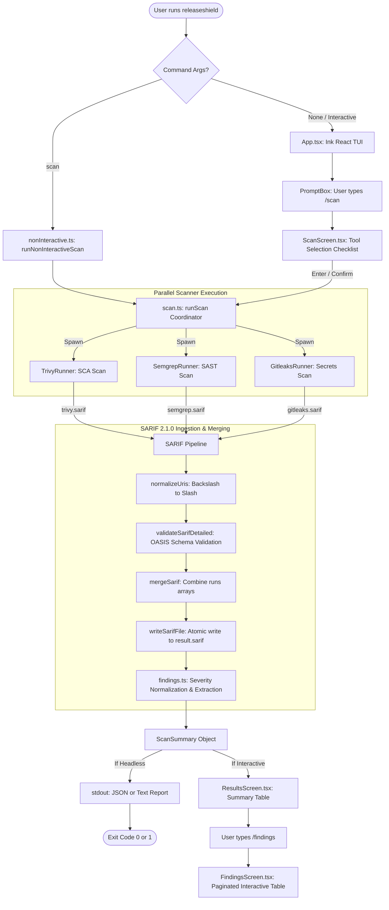

# ReleaseShield AI — Complete Technical Architecture & Execution Flow

> **Version:** 1.0.0  
> **Target Standard:** OASIS SARIF 2.1.0 (Static Analysis Results Interchange Format)  
> **Engines Orchestrated:** Trivy (SCA/Misconfig), Semgrep (SAST), Gitleaks (Secrets)  
> **UI Layer:** React Ink Terminal User Interface (TUI) & Headless Non-Interactive CLI  

---

## 1. High-Level System Architecture

ReleaseShield AI is organized as a modular TypeScript monorepo with strict separation of concerns between presentation (`@releaseshield/cli`) and domain logic (`@releaseshield/core`).

```
+-----------------------------------------------------------------------------------+
|                                 USER INTERFACE                                    |
|                                                                                   |
|  [Headless CI/CD Mode]                             [Interactive Terminal (Ink)]   |
|  releaseshield scan ./repo --tools all --json      releaseshield                  |
|          |                                                 |                      |
|          v                                                 v                      |
|  +--------------------+                           +----------------------------+  |
|  | nonInteractive.ts  |                           | App.tsx (Root Component)   |  |
|  +--------------------+                           +----------------------------+  |
|          |                                                 |                      |
|          |                                        +--------+--------+             |
|          |                                        | Command Handler |             |
|          |                                        | (/scan,/results)|             |
|          |                                        +--------+--------+             |
|          |                                                 |                      |
|          |                                        +--------v---------+            |
|          |                                        |  ScanScreen.tsx  |            |
|          |                                        +--------+---------+            |
+----------|-------------------------------------------------|----------------------+
           |                                                 |
           +-----------------------+-------------------------+
                                   |
                                   v
+-----------------------------------------------------------------------------------+
|                        CORE SCAN ORCHESTRATION (@releaseshield/core)             |
|                                                                                   |
|                              +------------------+                                 |
|                              |   runScan()      |                                 |
|                              |  (scan.ts)       |                                 |
|                              +--------+---------+                                 |
|                                       |                                           |
|             +-------------------------+-------------------------+                 |
|             | (Parallel Execution via Promise.all)             |                 |
|             v                                                   v                 |
|  +----------------------+  +----------------------+  +----------------------+     |
|  |     TrivyRunner      |  |    SemgrepRunner     |  |    GitleaksRunner    |     |
|  |  (SCA / Vulnerab.)   |  |     (SAST Rules)     |  |   (Secrets / Keys)   |     |
|  +----------+-----------+  +----------+-----------+  +----------+-----------+     |
|             |                         |                         |                 |
|      trivy.sarif               semgrep.sarif             gitleaks.sarif           |
|             |                         |                         |                 |
|             +-------------------------+-------------------------+                 |
|                                       |                                           |
|                                       v                                           |
|  +-----------------------------------------------------------------------------+  |
|  |                           SARIF 2.1.0 PIPELINE                              |  |
|  |                                                                             |  |
|  |  1. readSarifFile() / parseSarif()                                          |  |
|  |     -> UTF-8 File Ingestion                                                 |  |
|  |     -> normalizeUris() (Windows backslash to RFC 3986 forward slash)         |  |
|  |     -> Schema Validation (OASIS SARIF 2.1.0 via Ajv Draft-04)               |  |
|  |                                                                             |  |
|  |  2. mergeSarif()                                                            |  |
|  |     -> Combines runs[] arrays from all successful scanners                  |  |
|  |     -> Validates unified document integrity                                 |  |
|  |                                                                             |  |
|  |  3. writeSarifFile()                                                        |  |
|  |     -> Atomic write via temporary staging file (.tmp)                       |  |
|  |     -> Output: results/result.sarif                                         |  |
|  |                                                                             |  |
|  |  4. findings.ts                                                             |  |
|  |     -> Rule metadata extraction & severity normalization (High/Med/Low)     |  |
|  |     -> countFindings() & extractFindings()                                  |  |
|  +------------------------------------+----------------------------------------+  |
|                                       |                                           |
|                                       v                                           |
|                              +------------------+                                 |
|                              |   ScanSummary    |                                 |
|                              +--------+---------+                                 |
+---------------------------------------|-------------------------------------------+
                                        |
       +--------------------------------+--------------------------------+
       |                                                                 |
       v                                                                 v
+-----------------------------+                   +----------------------------------+
|      NON-INTERACTIVE        |                   |         INTERACTIVE TUI          |
|  - Formatted CLI Text       |                   |  - ResultsScreen (Summary Table) |
|  - Machine-readable JSON    |                   |  - FindingsScreen (Pagination)   |
|  - Process Exit (0 or 1)    |                   |  - Dynamic StatusBar Update      |
+-----------------------------+                   +----------------------------------+
```

---

## 2. End-to-End Technical Execution Flow

```
[Start CLI Execution]
        |
        v
[1. index.tsx: Entry Point]
        |-- (Flag: --help) ----------> Print Usage Help & exit(0)
        |-- (Command: scan) ---------> [2A. Headless Non-Interactive Flow]
        +-- (No command & TTY) ------> [2B. Interactive Ink TUI Flow]
```

### Step 1: Process Entry & Flag Parsing (`index.tsx` & `nonInteractive.ts`)
1. Node.js executes `cli_frontend/packages/cli/src/index.tsx`.
2. `parseCliArgs(process.argv)` evaluates flags and subcommands:
   - `scan <target>`: Triggers automated/headless execution.
   - `--tools <trivy,semgrep,gitleaks|all>`: Selects security scanners.
   - `--json`: Enables structured JSON output for CI/CD integrations.
   - `--fail <tool>`: Simulates scanner failure for pipeline testing.
   - `--help / -h`: Displays CLI documentation.
3. If executed without arguments:
   - Checks `process.stdin.isTTY`. If non-interactive stdin is detected, exits with guidance.
   - If interactive TTY is detected, mounts Ink React application `<App />`.

---

### Step 2A: Non-Interactive Execution Flow (`runNonInteractiveScan`)
For automation, GitHub Actions, and CI/CD pipelines:
1. `runNonInteractiveScan(options)` is invoked.
2. Directly executes `runScan(options.tools, undefined, { targetPath, failTool })`.
3. Awaits completion and receives `ScanSummary`.
4. **Output Dispatch**:
   - If `--json`: Outputs uncolored, formatted JSON string of `ScanSummary` to `stdout`.
   - If plain text: Prints tool status, durations, severity counts, and the saved SARIF path.
5. **Exit Code Evaluation**:
   - If any tool failed: Returns exit code `1`.
   - If all tools succeeded: Returns exit code `0`.

---

### Step 2B: Interactive TUI Flow (`App.tsx` & Ink Framework)
When run interactively in a developer's terminal:
1. **Component Hierarchy**:
   ```
   <App>
     ├── <Header />                  // ASCII Banner & Version Info
     ├── <Divider />
     ├── <StatusBar />               // Target Repo, Active Tools, Last Scan Timestamp
     ├── <Divider />
     ├── <MainArea>                  // Dynamic viewport for active screens
     │     └── {outputNode}          // (HelpScreen | ScanScreen | ResultsScreen | FindingsScreen)
     ├── <Divider />
     ├── <PromptBox />               // Command prompt: user typing input
     └── <HintLine />                // Keybinding shortcuts & hints
   ```
2. User types `/scan [path]` or `/scan`:
   - `parseCommand(input)` extracts command name, positional arguments, and flags.
   - Command registry routes input to the `/scan` handler in `handlers.tsx`.
   - Context switches `outputNode` to `<ScanScreen />`.

---

### Step 3: Interactive Scan State Machine (`ScanScreen.tsx`)

The scan screen operates a 3-phase state machine:

```
+---------------------------------------------------------------------------------+
|                                 SCAN SCREEN                                     |
|                                                                                 |
|  [Phase 1: Selecting]                                                           |
|    Interactive checklist of tools (↑/↓ to navigate, Space to toggle, Enter)     |
|    - [✓] Trivy                                                                  |
|    - [ ] Semgrep                                                                |
|    - [✓] Gitleaks                                                              |
|                     |                                                           |
|                     v (User presses Enter or tools pre-selected)                |
|  [Phase 2: Running]                                                             |
|    - PromptBox disabled to capture control                                      |
|    - Live spinners rendered per tool via ink-spinner                            |
|    - Real-time elapsed duration ticks (100ms refresh rate)                       |
|    - Parallel invocation of runScan() with AbortController                      |
|                     |                                                           |
|                     v (All scanners finish execution)                           |
|  [Phase 3: Complete]                                                            |
|    - Transition to <ResultsScreen summary={summary} />                          |
|    - Re-enables PromptBox                                                       |
|    - Triggers onComplete() callback to update App-level state                   |
+---------------------------------------------------------------------------------+
```

---

### Step 4: Core Scanner Orchestration Engine (`scan.ts`)

`runScan(tools, onUpdate, options)` is the central coordinator of ReleaseShield:

1. **Output Path Resolution**:
   - Identifies report destinations (`results/result.sarif`, `results/<tool>.sarif`).
   - Recursively removes stale report files from prior runs using `fs.rm(..., { force: true })` to eliminate false positives.
2. **Subprocess Environment Augmentation (`getAugmentedEnv()`)**:
   - **Windows UTF-8 Encoding**: Injects `PYTHONUTF8=1` and `PYTHONIOENCODING=utf-8` to prevent Python-based scanners (Semgrep) from crashing on Unicode/emojis (e.g., rule metadata `💎`).
   - **WinGet Path Resolution**: Automatically discovers and prepends WinGet package paths and Python Scripts to `process.env.PATH`.
3. **Parallel Subprocess Spawning (`Promise.all`)**:
   - Runs `TrivyRunner`, `SemgrepRunner`, and `GitleaksRunner` concurrently.
   - Emits real-time progress events (`running`, `elapsedSec`) via `onUpdate` callback.

```
                           +----------------------+
                           |  runScan() Spawner   |
                           +----------+-----------+
                                      |
            +-------------------------+-------------------------+
            |                         |                         |
            v                         v                         v
  +--------------------+    +--------------------+    +--------------------+
  |    trivy fs        |    |    semgrep scan    |    |    gitleaks dir    |
  | --format sarif     |    | --config p/default |    | --report-format    |
  | --output <path>    |    | --metrics=off      |    |   sarif            |
  | <targetPath>       |    | --sarif            |    | --report-path      |
  |                    |    | --output <path>    |    |   <path>           |
  |                    |    | <targetPath>       |    | --source <target>  |
  +---------+----------+    +---------+----------+    +---------+----------+
            |                         |                         |
            v                         v                         v
     Exit Code Eval            Exit Code Eval            Exit Code Eval
     0: Success                0 or 1: Success           0 or 1: Success
     >=1: Failed               >=2: Fatal Failure        >=2: Fatal Failure
```

---

### Step 5: SARIF Ingestion, Normalization & Validation (`packages/core/src/sarif/`)

Every individual tool output is subjected to strict pipeline validation:

```
[Raw Tool Output on Disk: *.sarif]
              |
              v
     readSarifFile(path)
              |
              v
     parseSarif(rawJson)
              |
              +---> JSON.parse()
              |
              +---> normalizeUris()
              |     Replaces all backslashes "\" in artifactLocation URIs
              |     with forward slashes "/" (Windows SARIF Compliance)
              |
              +---> validateSarifDetailed()
                    Compiled Ajv (Draft-04) against official OASIS 
                    SARIF 2.1.0 JSON Schema
```

- **Windows RFC 3986 Compliance**: Semgrep and native Windows tools emit paths with backslashes (e.g., `src\models\user.ts`). The OASIS SARIF 2.1.0 specification (Section 3.10.1) explicitly prohibits backslashes in `uri-reference` fields. `normalizeUris()` recursively traverses the JSON AST and normalizes all URI values before validation.
- **Fail-Safe Integrity**: If a scanner emits invalid JSON or non-compliant SARIF, the error is captured, that specific tool is marked as `failed`, and valid reports from other tools remain unaffected.

---

### Step 6: Multi-Scanner SARIF Merger (`merger.ts`)

Once individual tool reports are validated:
1. `mergeSarif(sarifLogs: SarifLog[])`:
   - Collects each valid log's `runs[]` array.
   - Combines them into a single consolidated root SARIF object:
     ```json
     {
       "version": "2.1.0",
       "$schema": "https://docs.oasis-open.org/sarif/sarif/v2.1.0/errata01/os/schemas/sarif-schema-2.1.0.json",
       "runs": [
         { "tool": { "driver": { "name": "Trivy" } }, "results": [...] },
         { "tool": { "driver": { "name": "Semgrep" } }, "results": [...] },
         { "tool": { "driver": { "name": "Gitleaks" } }, "results": [...] }
       ]
     }
     ```
   - Re-validates the combined SARIF document against the official schema via `assertValidSarif()`.
2. `writeSarifFile(finalOutputPath, merged)`:
   - Implements **atomic publication**:
     - Writes to temporary file: `<path>.<timestamp>-<random>.sarif.tmp`.
     - Flushes contents to disk.
     - Atomically renames temporary file to `result.sarif`.
     - Cleans up temporary file if write fails.

---

### Step 7: Severity Normalization & Finding Extraction (`findings.ts`)

ReleaseShield normalizes divergent scanner reporting conventions into a unified schema:

#### Severity Score Resolution
1. **CVSS / Security-Severity Score**:
   - `score >= 7.0` $\rightarrow$ **High**
   - `4.0 <= score < 7.0` $\rightarrow$ **Medium**
   - `score < 4.0` $\rightarrow$ **Low**
2. **SARIF Default Level Fallback**:
   - `error` $\rightarrow$ **High**
   - `warning` $\rightarrow$ **Medium**
   - `note` / `none` $\rightarrow$ **Low**
   - Unspecified $\rightarrow$ **Medium**

#### Finding Model
```typescript
export interface Finding {
  tool: 'trivy' | 'semgrep' | 'gitleaks';
  rule: string;            // Vulnerability ID or Rule Name (e.g. CVE-2018-3721)
  severity: 'high' | 'medium' | 'low';
  location: string;        // Normalized relative file path
  line?: number;           // Line number where vulnerability was detected
  message: string;         // Descriptive title / remediation hint
}
```

---

## 3. Terminal User Interface Screens & Visuals

### A. Main Scan Screen (`ScanScreen.tsx`)

#### Phase 1: Tool Selection Checklist
```text
Select tools

❯ [✓] Trivy
  [ ] Semgrep
  [✓] Gitleaks

↑ ↓ move   Space toggle   Enter scan   Esc cancel
```

#### Phase 2: Live Scanning Execution
```text
Scanning…

✓ Trivy         done        18.2s
⠋ Semgrep       running     12.4s
○ Gitleaks      waiting
```

---

### B. Scan Results Screen (`ResultsScreen.tsx`)

Rendered upon scan completion or when the user invokes `/results`:

```text
Trivy      done        18.2s
Semgrep    done        41.7s
Gitleaks   done         6.9s

Tool          High    Medium   Low   Total
Trivy           92         0     0      92
Semgrep         10        23     2      35
Gitleaks         3         0     0       3
Total          105        23     2     130   total time 42s

Saved: ./cli_frontend/results/result.sarif
```

---

### C. Interactive Paginated Findings Screen (`FindingsScreen.tsx`)

Invoked via `/findings` with optional flags (`--severity high`, `--tool semgrep`):

```text
Severity  Tool       Rule                               Location
──────────────────────────────────────────────────────────────────────────
High      Trivy      CVE-2018-3721                      package-lock.json:42
High      Trivy      CVE-2020-8203                      package-lock.json:115
High      Semgrep    javascript.express.security.audit  app/routes/index.js:14
High      Gitleaks   generic-api-key                    config/credentials.js:8
Medium    Semgrep    javascript.lang.security.detect    app/utils/auth.js:29
Low       Semgrep    javascript.express.security.cors   server.js:52

page 1 of 13 (130 total)   [n] next   [p] prev   [Enter/Esc] exit
```

---

### D. Headless CI/CD JSON Output (`releaseshield scan . --tools all --json`)

Machine-readable output piped directly into build runners:

```json
{
  "tools": [
    {
      "tool": "trivy",
      "status": "done",
      "durationSec": 18.2,
      "counts": { "high": 92, "medium": 0, "low": 0 }
    },
    {
      "tool": "semgrep",
      "status": "done",
      "durationSec": 41.7,
      "counts": { "high": 10, "medium": 23, "low": 2 }
    },
    {
      "tool": "gitleaks",
      "status": "done",
      "durationSec": 6.9,
      "counts": { "high": 3, "medium": 0, "low": 0 }
    }
  ],
  "totalCounts": {
    "high": 105,
    "medium": 23,
    "low": 2
  },
  "totalDurationSec": 41.7,
  "savedPath": "./cli_frontend/results/result.sarif"
}
```

---

## 4. Source File Index & Responsibilities

| File Path | Role & Primary Exports | Key Responsibilities |
| :--- | :--- | :--- |
| `packages/cli/src/index.tsx` | CLI Entry Point | CLI flag parsing, TTY detection, routing to Ink or non-interactive runner. |
| `packages/cli/src/nonInteractive.ts` | `parseCliArgs`, `runNonInteractiveScan` | Headless execution for CI/CD pipelines, uncolored JSON or plain text output. |
| `packages/cli/src/App.tsx` | `<App />`, `resolveRepoName` | Root Ink component, terminal layout, global scan state management. |
| `packages/cli/src/commands/handlers.tsx` | `registerDefaultCommands` | Registers `/scan`, `/results`, `/findings`, `/tools`, `/help`, `/quit`, `/clear`. |
| `packages/cli/src/screens/ScanScreen.tsx` | `<ScanScreen />` | 3-phase scan state machine: tool selection, live execution progress, result handoff. |
| `packages/cli/src/screens/ResultsScreen.tsx` | `<ResultsScreen />` | Renders scan status, duration, and findings breakdown table. |
| `packages/cli/src/screens/FindingsScreen.tsx` | `<FindingsScreen />` | Interactive paginated table of individual security findings with keyboard navigation. |
| `packages/core/src/scan.ts` | `runScan`, `buildSummary` | Core orchestration coordinator: spawns runners in parallel, manages temp files. |
| `packages/core/src/Scanner/tools.ts` | `BaseToolRunner`, `getAugmentedEnv` | Subprocess launcher, Windows UTF-8 environment injection, exit code evaluation. |
| `packages/core/src/Scanner/trivy.ts` | `TrivyRunner`, `isTrivyAvailable` | Trivy CLI argument builder and runner. |
| `packages/core/src/Scanner/semgrep.ts` | `SemgrepRunner`, `isSemgrepAvailable` | Semgrep CLI argument builder and runner. |
| `packages/core/src/Scanner/gitleaks.ts` | `GitleaksRunner`, `isGitleaksAvailable`| Gitleaks CLI argument builder and runner. |
| `packages/core/src/sarif/parser.ts` | `parseSarif`, `readSarifFile`, `writeSarifFile` | JSON parsing, URI backslash normalization, atomic disk writes. |
| `packages/core/src/sarif/validator.ts` | `assertValidSarif`, `validateSarifDetailed` | Ajv Draft-04 OASIS SARIF 2.1.0 schema compilation & validation. |
| `packages/core/src/sarif/merger.ts` | `mergeSarif` | Merges multiple SARIF `runs[]` arrays into a single unified SARIF document. |
| `packages/core/src/sarif/findings.ts` | `extractFindings`, `countFindings`, `filterFindings` | Normalized finding extraction, severity mapping (CVSS/levels to High/Med/Low). |
| `packages/core/src/types.ts` | TypeScript Interfaces | Data models: `ScanSummary`, `ToolResult`, `Finding`, `SarifLog`, `SeverityCounts`. |

---

## 5. Architectural Flow Chart (Ready for Diagramming)

Use this flowchart to render in visual diagram tools (Mermaid, Draw.io, or Miro):



