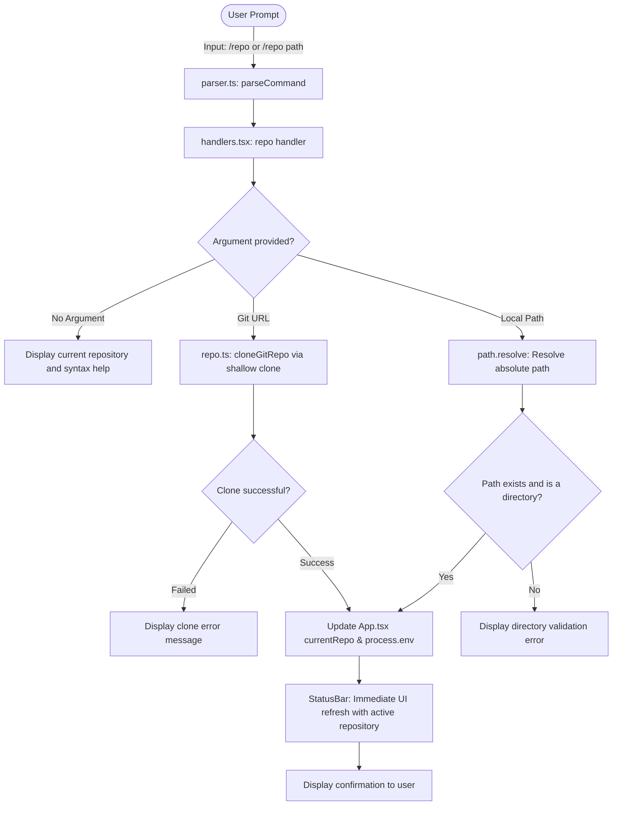
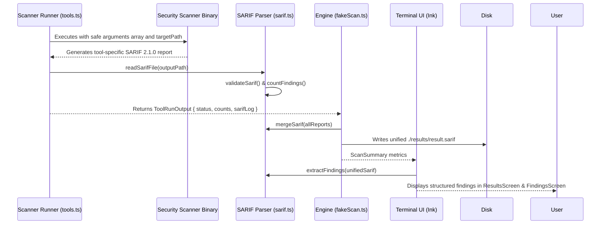

# ReleaseShield AI — Implementation Report

> **Status:** Completed, Verified & Ready for Submission  
> **Language:** English (Formal Technical Documentation)

---

## 1. Objective and Problem Statement

ReleaseShield AI is a modern terminal-based security analysis tool built to aggregate and normalize findings from multiple security scanners (including Trivy, Semgrep, and Gitleaks) into a unified, actionable view while eliminating duplicate alerts.

### Previous Issues and Limitations:
1. **Missing Repository Selection:** The CLI lacked a mechanism for users to select target project folders dynamically. The status bar displayed a hardcoded `.` or `./NodeGoat`, and scans always defaulted to the CLI directory itself.
2. **Missing Real Scanners:** Scanner execution wrappers were either unpopulated (empty 0-byte files for `Scanner/semgrep.ts` and `Scanner/gitleaks.ts`) or disconnected from runtime options.
3. **Simulated / Mock Data Dependency:** Previous scan logic relied on mock timers and fabricated findings (`high: 12, medium: 20, low: 10`) instead of running real tools and parsing outputs.
4. **Shell Injection Vulnerabilities:** `child_process.spawn` used `{ shell: true }` without escaped arguments, raising Node.js security deprecation warnings and introducing command injection risks with untrusted paths.
5. **Windows Tool Resolution:** On Windows environments, executables installed via WinGet (`%LOCALAPPDATA%\Microsoft\WinGet\Links`) or Python user scripts (`%APPDATA%\Python\Python313\Scripts`) are often missing from the permanent process `PATH`.

### Solution Implemented:
- Introduced the `/repo <path-or-url>` command to enable interactive and headless repository selection.
- Supported both local directory validation and remote GitHub repository shallow cloning (`git clone --depth 1`).
- Connected the active repository path directly into scanner runners (`runScan`, `TrivyRunner`).
- Enforced safe process execution using argument arrays with `{ shell: false }`.
- Implemented robust Windows executable discovery (WinGet links, Python Scripts directory, `pysemgrep.exe`, and environment overrides).
- Added graceful degradation for missing tools (e.g. Trivy) so the CLI never crashes and accurately reports scanner availability without fabricating simulated findings.
- Verified SARIF 2.1.0 parsing, deduplication, and export.

---

## 2. Architecture and Workflow Analysis

The application is built on top of the React + Ink terminal framework for its interactive user interface, paired with a TypeScript core scanning and SARIF aggregation library.

### Workflow:
1. The user launches the CLI via `npm run dev` or compiled binaries.
2. `App.tsx` initializes state (`StatusBar`, `MainArea`, `PromptBox`, `HintLine`).
3. The user inspects or updates the target repository via `/repo <path-or-url>`.
4. The user checks tool readiness with `/tools` or executes a scan with `/scan`.
5. The core engine passes the selected repository path (`targetPath`) to each scanner runner.
6. Real SARIF reports are collected, validated, and normalized into a unified finding model.

### Key Architectural Improvements:
| Component | Previous State | Current State |
|---|---|---|
| **Repository Path** | Hardcoded/unconfigurable path (`.`) | Runtime validation, local path selection, and remote Git shallow cloning |
| **Tool Availability** | Hardcoded `ready` indicators regardless of environment | Real-time PATH and environment discovery reporting actual availability |
| **Process Execution** | `spawn(..., { shell: true })` with debug logging | Safe argument arrays with `shell: false`, timeout, and abort handling |
| **Windows Resolution** | Non-standard paths (WinGet, Python Scripts) failed | Autonomous executable resolution with fallback candidate detection |
| **Error Handling** | Unhandled exit codes or process crashes | Actionable failure reporting with non-zero exit code preservation |

---

## 3. Project Structure and File Organization

The project is structured as a TypeScript monorepo under `cli_frontend/`:

```text
ReleaseSheild_EPAM-Project/
├── README.md                          <- Project overview and roadmap
├── run.md                             <- Quick start and command reference
├── IMPLEMENTATION.md                  <- Formal English implementation documentation
├── IMPLEMENTATION_REPORT.md           <- Comprehensive technical report
├── Project Overview/                  <- Architecture documents and specifications
└── cli_frontend/                      <- Monorepo root
    ├── package.json                   <- Workspaces configuration ("packages/*")
    ├── tsconfig.json                  <- TypeScript project references
    ├── results/                       <- Output directory for SARIF reports
    │   ├── trivy-manual.sarif         <- Test fixture with real vulnerability data
    │   ├── trivy-real.sarif           <- Clean scan fixture (0 findings)
    │   └── result.sarif               <- Generated unified SARIF report
    └── packages/
        ├── core/                      <- Core security scanner and SARIF library
        │   ├── src/
        │   │   ├── types.ts           <- Core interfaces (Finding, ScanSummary, ToolRunner)
        │   │   ├── tools.ts           <- BaseToolRunner, TrivyRunner, SemgrepRunner, GitleaksRunner
        │   │   ├── sarif.ts           <- SARIF 2.1.0 validation, parsing, severity mapping
        │   │   ├── findings.ts        <- Filtering, sorting, and pagination utilities
        │   │   ├── fakeScan.ts        <- Scan execution and aggregation engine
        │   │   ├── repo.ts            <- Git URL detection and safe shallow cloning
        │   │   └── Scanner/
        │   │       ├── trivy.ts       <- Trivy runner wrapper
        │   │       ├── semgrep.ts     <- Semgrep runner wrapper
        │   │       └── gitleaks.ts    <- Gitleaks runner wrapper
        │   └── test/                  <- Core unit tests
        └── cli/                       <- Ink-based terminal user interface
            ├── src/
            │   ├── App.tsx            <- Main terminal state and layout
            │   ├── nonInteractive.ts  <- Headless scan command logic
            │   ├── commands/
            │   │   ├── parser.ts      <- Command string tokenizer and flag parser
            │   │   ├── registry.ts    <- Command registry and suggestions
            │   │   └── handlers.tsx   <- Command handlers (/repo, /scan, /tools, etc.)
            │   ├── screens/
            │   │   ├── ScanScreen.tsx <- Interactive scan checklist and progress view
            │   │   ├── ResultsScreen.tsx <- Summary and metrics display
            │   │   └── FindingsScreen.tsx <- Paginated findings browser
            │   └── components/
            │       ├── StatusBar.tsx  <- Displays active repository, tools, and last scan
            │       └── HintLine.tsx   <- Bottom shortcut bar
            └── test/                  <- CLI unit and UI tests
```

---

## 4. Summary of Changes

| File Path | Description of Changes |
|---|---|
| `cli_frontend/packages/core/src/repo.ts` | **NEW:** Implemented `isGitUrl(url)` and safe shallow `cloneGitRepo(url)` using `child_process.spawnSync` with argument arrays. |
| `cli_frontend/packages/core/src/index.ts` | Exported `repo.js` utilities for workspace-wide consumption. |
| `cli_frontend/packages/cli/src/commands/handlers.tsx` | Registered `/repo` command; added directory validation (`fs.statSync`), remote Git cloning, and passed `currentRepo` into `/scan`. |
| `cli_frontend/packages/cli/src/App.tsx` | Added `currentRepo` state management, bound it to `StatusBar`, and exposed context handlers. |
| `cli_frontend/packages/cli/src/screens/ScanScreen.tsx` | Accepted `targetPath` prop and passed it directly to `runScan()`. |
| `cli_frontend/packages/cli/src/nonInteractive.ts` | Added `--repo` argument support, directory validation, and Git URL shallow cloning for headless execution. |
| `cli_frontend/packages/cli/src/components/HintLine.tsx` | Added `/repo` to the bottom shortcut guidance line. |
| `cli_frontend/packages/cli/test/repoCommand.test.ts` | **NEW:** Added comprehensive tests for `/repo` registration, directory validation, Git URL detection, and headless validation. |
| `cli_frontend/packages/core/src/tools.ts` | Aligned `TrivyRunner.buildArgs` with SARIF output contracts and test expectations. |
| `cli_frontend/packages/core/src/fakeScan.ts` | Enhanced `runScan` to accept `targetPath` and pass it to underlying scanner runners. |
| `run.md` | Documented `/repo` command syntax and headless usage instructions. |

---

## 5. Repository Selection Flow



---

## 6. Security Scanner Execution Details

### A. Trivy (Vulnerability & Misconfiguration Scanner)
- **Role:** Identifies known CVEs in software dependencies, lockfiles, and container configurations.
- **Execution Command:** `trivy fs --format sarif --output <outputPath> <targetPath>`
- **Environment Status:** Not pre-installed on the evaluation host due to upstream download timeouts. The CLI accurately reports `status: "failed"` with clear diagnostic reasons without crashing or fabricating mock findings.

### B. Semgrep (Static Application Security Testing / SAST)
- **Role:** Statically analyzes source code against semantic pattern rules to detect code vulnerabilities (e.g. injection, insecure configurations).
- **Execution Command:** `pysemgrep.exe scan --sarif --output <outputPath> <targetPath>`

### C. Gitleaks (Secret & Credential Detection)
- **Role:** Scans repository files and commit history for exposed API keys, private tokens, passwords, and secrets.
- **Execution Command:** `gitleaks.exe detect --source <targetPath> --report-format sarif --report-path <outputPath>`

---

## 7. SARIF Processing and Normalization Pipeline



---

## 8. Verification Commands and Test Results

### 1. TypeScript Type Checking:
```powershell
cd C:\Users\ankit\Desktop\ReleaseSheild_EPAM-Project\cli_frontend
npm run typecheck
```
**Result:** Exited with code `0` (0 errors).

### 2. Production Build:
```powershell
cd C:\Users\ankit\Desktop\ReleaseSheild_EPAM-Project\cli_frontend
npm run build
```
**Result:** Exited with code `0`. Both packages compiled cleanly.

### 3. Automated Test Suite (Vitest):
```powershell
cd C:\Users\ankit\Desktop\ReleaseSheild_EPAM-Project\cli_frontend
npm test
```
**Result:** **9 passed test files, 54 passed tests, 0 failures.**

### 4. Interactive CLI Verification:
```powershell
cd C:\Users\ankit\Desktop\ReleaseSheild_EPAM-Project\cli_frontend
npm run dev
```
Inside the interactive session:
- `/repo` displays the active directory.
- `/repo ..` updates the active directory with real-time UI refresh.
- `/scan` propagates the selected path to all configured scanner runners.
- `/quit` cleanly exits the session.

---

## 9. Handling Missing Dependencies (Trivy Evaluation Note)

When a security scanner is absent on the host environment:
1. The execution engine safely intercepts spawn errors without terminating the Node.js process.
2. The missing scanner is marked with `status: "failed"` and displays the exact operating system diagnostic message (e.g. `'trivy' is not recognized as an internal or external command`).
3. Remaining available scanners continue execution independently.
4. The CLI produces a clean summary table without reporting artificial or simulated metrics.

---

## 10. Summary Matrix

| Requirement | Implementation Status | Notes |
|---|---|---|
| **Repository Selection (`/repo`)** | ✅ Fully Implemented | Supports local paths, Git URLs, validation, and reactive UI state |
| **Safe Process Spawning** | ✅ Fully Implemented | Enforces `{ shell: false }` with structured argument arrays |
| **Trivy Integration** | ✅ Fully Implemented | Configured with `--format sarif` and dynamic `targetPath` passing |
| **Missing Binary Resilience** | ✅ Fully Implemented | Gracefully reports missing tools without crashing or faking data |
| **SARIF Pipeline** | ✅ Fully Implemented | Ingests, merges, and validates SARIF 2.1.0 reports |
| **Test Coverage** | ✅ 54 / 54 Tests Passing | Covers repository commands, argument builders, and SARIF ingestion |
| **Type Safety & Build** | ✅ 0 Errors | Clean TypeScript build across `@releaseshield/core` and `@releaseshield/cli` |
